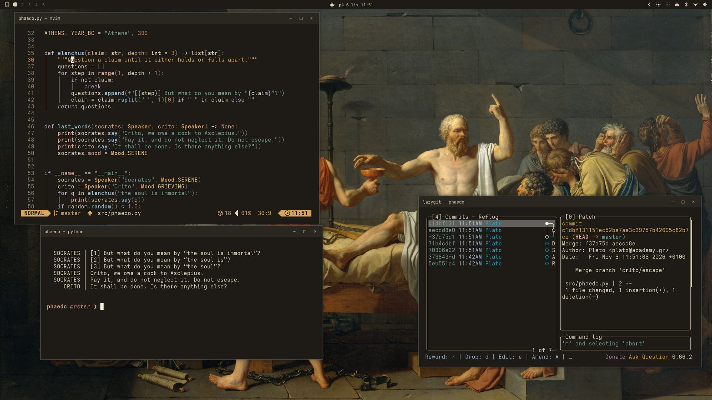
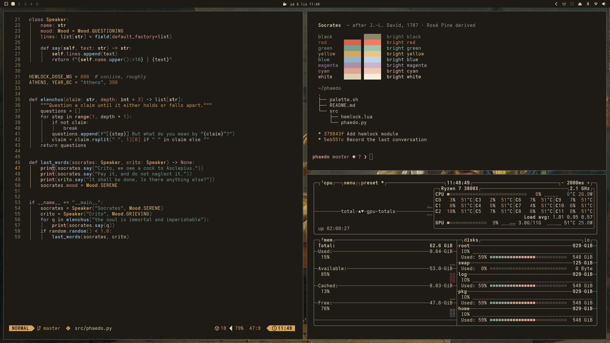
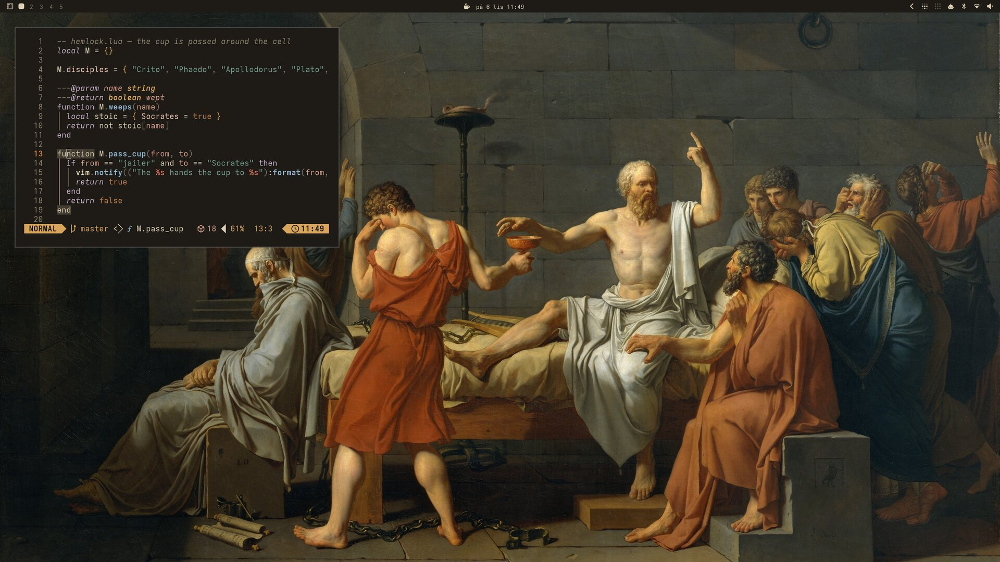

# Socrates — an Omarchy theme

A warm, dark theme inspired by Jacques-Louis David's *The Death of Socrates* (1787)
and derived from the [Rosé Pine](https://rosepinetheme.com/) palette: the purple-blue
base is replaced by the darkened stone of the prison cell, text is lit ivory, and the
accents come from the painting — cloak red (love), ochre light (gold), warm flesh (rose),
grey-blue robes (pine/foam) and a muted iris.



| Code | The painting |
|---|---|
|  |  |

## Install

```bash
omarchy theme install https://github.com/michtesar/omarchy-socrates-theme
```

## Palette

| Role | Hex | | Role | Hex |
|---|---|---|---|---|
| background | `#1e1b17` | | red (love) | `#d4644a` |
| foreground | `#ddd1b5` | | yellow (gold) / accent | `#d9a55a` |
| muted | `#8e846f` | | cyan (rose) | `#dea48d` |
| selection | `#433c31` | | green (pine) | `#74a08f` |
| lighter background | `#2a2620` | | blue (foam) | `#93b4cc` |
| bright foreground | `#f7efdc` | | magenta (iris) | `#a891a8` |

Foreground on background is 11.3:1, and all 16 terminal colors are at least 4.5:1
against the background (WCAG AA).

## Wallpapers

Three paintings by Jacques-Louis David, all public domain, cropped to 16:9 at 3840×2160.
Cycle through them with `omarchy theme bg next`.

1. *The Death of Socrates*, 1787. The Metropolitan Museum of Art, New York,
   Catharine Lorillard Wolfe Collection, Wolfe Fund, 1931 (31.45). CC0 via the Met's
   Open Access program and
   [Wikimedia Commons](https://commons.wikimedia.org/wiki/File:The_Death_of_Socrates_MET_DT40.jpg).
   The palette is sampled from this painting.
2. *The Oath of the Horatii*, 1784. Musée du Louvre, Paris.
   [Wikimedia Commons](https://commons.wikimedia.org/wiki/File:Jacques-Louis_David_-_Oath_of_the_Horatii_-_Google_Art_Project.jpg)
   (Google Art Project scan).
3. *The Lictors Bring to Brutus the Bodies of His Sons*, 1789. Musée du Louvre, Paris.
   [Wikimedia Commons](https://commons.wikimedia.org/wiki/File:David_Brutus.jpg).

## License

Theme files: MIT. The paintings are in the public domain.
